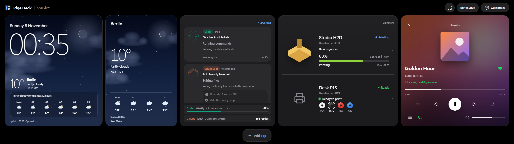
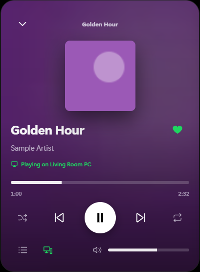
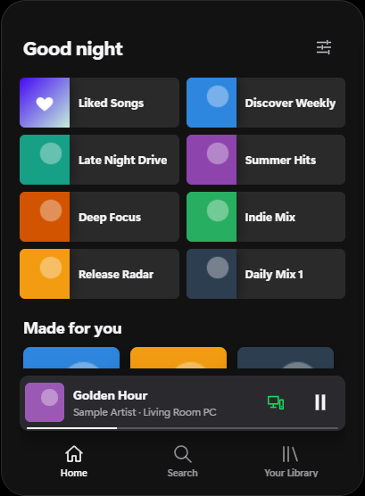
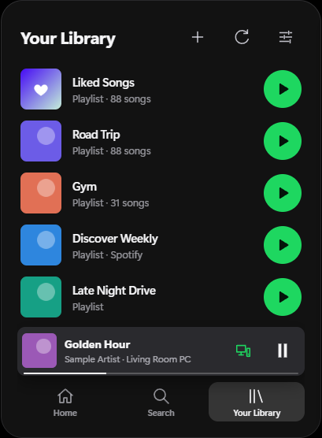
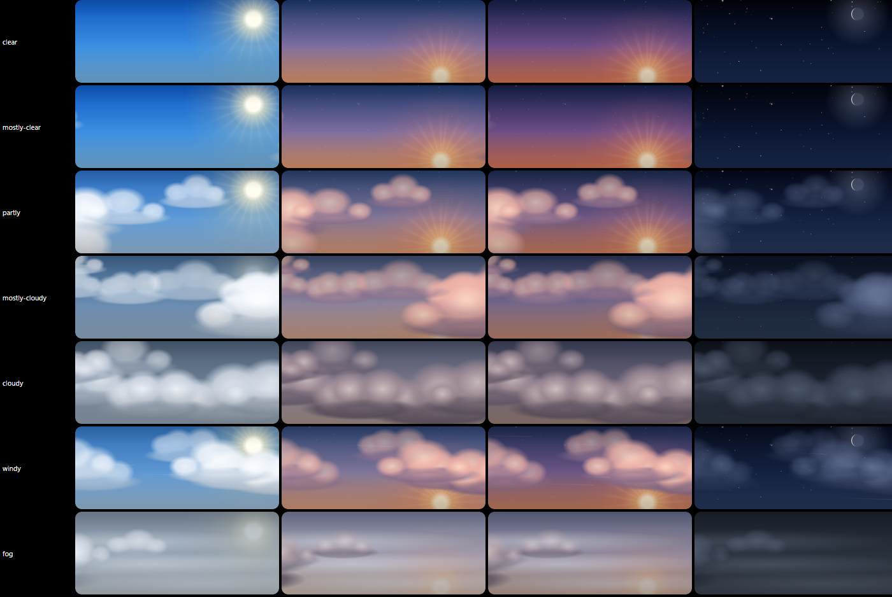

# Edge Deck

A touchscreen dashboard for the **Corsair XENEON EDGE** (the 14.5" 2560 × 720 touch display) on Windows. It shows your music, 3D printers, weather and AI coding agents at a glance, and runs quietly in the background with just an icon in the taskbar's notification area.



<sub>Shown with sample data.</sub>

The music card works like Spotify's mobile app: a full-screen player that slides down into a mini player above Home, Search and Your Library.

<p>
  
  
  
</p>



## Features

- **Music, like Spotify's mobile app.** A full-screen player that slides down into a mini player above Home, Search and Your Library tabs (tap or swipe up to open it again). Home shows your recent playlists, Liked Songs and Discover Weekly, then shelves such as Made for you, Jump back in and your top artists. Live progress, shuffle and repeat, likes, Spotify Connect devices, Up Next and per-device volume. Optional Spotify **Canvas** videos play behind the player. Without Spotify, it controls whatever plays in Windows.
- **Bambu Lab printers (H2D, P1S).** Live status over your local network: the printer's own preview of the model being printed, progress laid out like the printer's screen, a clear finished state, and the loaded AMS spools in their real colours when idle. Optional controls (pause, resume, stop, temperatures, axes, filament) and camera preview. Printer names can come from your Bambu account.
- **Weather.** Current conditions, hourly and seven-day forecast from Open-Meteo, over an animated sky with 24 conditions, each for day, sunrise, sunset and night. No API key or location tracking.
- **AI agents.** Working chats from Codex, Claude Code and the ChatGPT desktop app, with an animated orb for what each is doing, its step list and background tasks, and your plan usage. Optional: answer Claude Code permission requests on the touchscreen.
- **Notifications.** A Windows notification when a print finishes or fails (with a picture of the model) and when an agent waits for your approval. They wait while a game is full screen.
- **Quick actions and apps.** Switch audio devices, mute, system volume, and a dock of your apps and websites.
- **Your layout.** Cards you can add, combine, resize and rearrange by dragging; several layouts; low-power mode that calms animation while you game.

## Requirements

- Windows 10 or 11 with the XENEON EDGE connected as a display (any display works; the EDGE is detected automatically).
- [Node.js](https://nodejs.org) 20 or later. The installer can install it for you.
- Microsoft Edge (included with Windows). The dashboard runs as an Edge app window with its own private profile.

## Install

1. Download **edge-deck-x.y.z.zip** from the [latest release](https://github.com/sb3ku/edge-deck/releases/latest).
2. Right-click the zip → **Properties** → tick **Unblock** → **OK** (Windows marks downloads; this lets the installer script run).
3. Extract it and double-click **Install Edge Deck.cmd**.

The installer runs for your Windows user only (no administrator rights). It copies Edge Deck to `%LOCALAPPDATA%\Programs\Edge Deck`, adds it to the Start menu, can add a desktop shortcut and start with Windows, and registers it under **Settings → Apps → Installed apps**, where you can uninstall it. Your settings live in `%APPDATA%\Edge Deck` and survive reinstalling.

Why a script rather than a `setup.exe`: Windows Smart App Control blocks unsigned programs, and Edge Deck runs on the signed Node.js instead, so nothing unsigned has to be allowed.

Edge Deck lives in the taskbar's hidden icons (**^**) rather than on the taskbar. Click its icon to bring the dashboard back full screen; right-click for **Exit full screen**, **Check for updates** and **Quit**.

### Updates

Edge Deck checks this repository's releases every six hours. When a new version is out, the tray shows a notification and **Update to x.y.z**; one click downloads the release, checks it against the SHA-256 published with it, and reinstalls in place (your settings stay). **Customize → Display** shows the version and update status too. A copy run from a git checkout is not replaced; update it with Already up to date..

What changed in each version: [CHANGELOG.md](CHANGELOG.md).

To run from source instead: `npm install`, then `npm start`.

## Setup

Everything is set up on the dashboard under **Customize**.

### Spotify

1. Create an app in the [Spotify developer dashboard](https://developer.spotify.com/dashboard) and add the redirect URI `http://127.0.0.1:43821/callback`.
2. In **Customize → Music**, paste its Client ID and choose **Connect Spotify**.

Edge Deck uses PKCE (no client secret). Spotify's development mode requires the app owner to have Premium.

**Canvas videos and Spotify-made playlists (optional, unofficial).** Spotify doesn't give apps its Canvas videos or the playlists it makes for you (Discover Weekly, Release Radar, Daily Mixes). If you paste your own `sp_dc` cookie from open.spotify.com in **Customize → Music → Spotify Canvas videos**, Edge Deck reads them the way Spotify's web player does. This uses private endpoints that can change without notice and is outside Spotify's developer terms; use it at your own discretion. The cookie is stored encrypted and only sent to Spotify.

### Printers

In **Customize → Printers**, enter each printer's IP address, serial number and LAN access code (from the printer's network settings). Status is read-only unless you turn on **Enable LAN controls** for a printer.

**Bambu Lab account (optional).** Sign in under **Customize → Printers → Bambu Lab account** to show your printers' names and the exact preview of each print from your print history, for printers that don't share their files (an H2D without a USB drive). Your password goes to Bambu Lab only; Edge Deck keeps just the sign-in token, encrypted.

**Printer photos.** Edge Deck doesn't include printer photos (they belong to Bambu Lab). Add your own as described in [`src/assets/printers/README.md`](src/assets/printers/README.md); otherwise the card shows an icon.

### Weather and agents

Tap the weather to choose your city. Agent chats appear automatically when Codex, Claude Code or the ChatGPT app run on the same PC.

## Privacy and security

- Everything runs on your PC. The dashboard's local server listens only on `127.0.0.1` with a per-launch secret.
- Sign-ins (Spotify, printer access codes, Bambu, Canvas) are encrypted with Windows user encryption (AES-256-GCM with a DPAPI-protected key) in `%APPDATA%\Edge Deck`.
- Agent activity is read from the agents' local log files; only text the agent showed you is used, never prompts, commands or thinking.
- For notifications, Edge Deck registers its name and an `edgedeck:` link (which only opens the dashboard) for your user under `HKCU\Software\Classes`; the uninstaller removes them.
- No telemetry. Network requests go only to the services you connect (Spotify, Open-Meteo, Bambu Lab, Iconify for app icons, your printers).

## Development

```bash
npm install
npm test          # unit tests
npm run check     # syntax checks
npm run verify:ui # end-to-end check in a separate Edge window with temporary settings
```

`main.cjs` runs the background service; `lib/` holds the integrations (each returns plain data), `src/` the dashboard. `scripts/create-app-icon.cjs` builds the icon from `src/assets/app/edge-deck.svg`.

## Notes

Edge Deck is an independent project, not affiliated with or endorsed by Corsair, Bambu Lab, Spotify, OpenAI or Anthropic. It uses the unofficial Bambu LAN protocol and some unofficial endpoints described above, which can change at any time.

Agent orbs are drawn with [thinking-orbs](https://github.com/Jakubantalik/thinking-orbs) by Jakub Antalik (MIT). Weather data by [Open-Meteo](https://open-meteo.com). App icons from [Iconify](https://iconify.design).

## License

[MIT](LICENSE)
